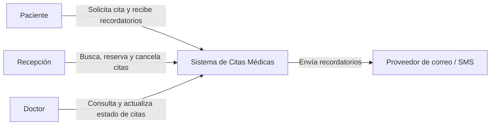
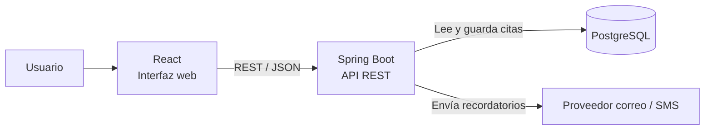
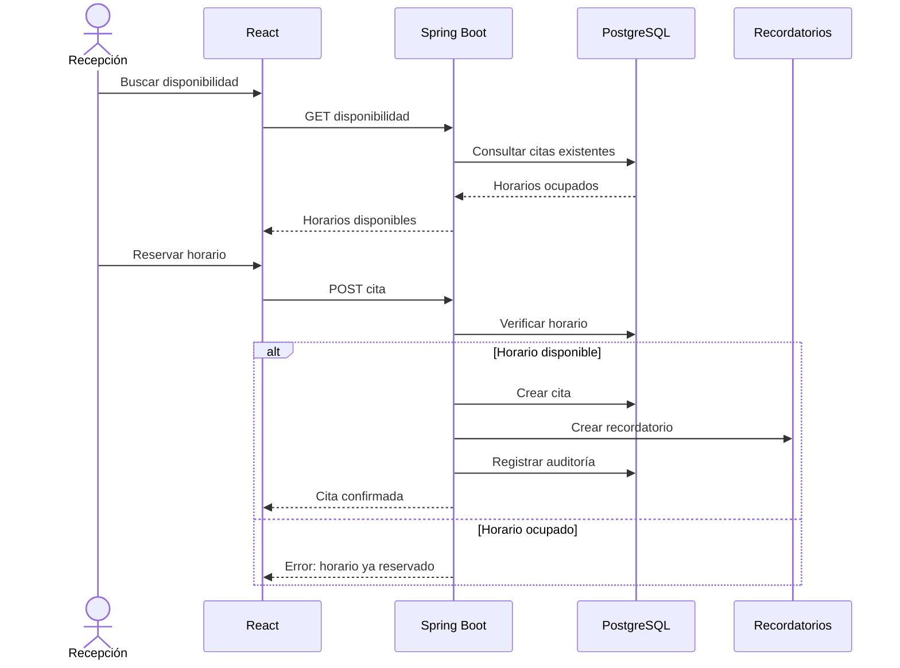

# Citas médicas

Sistema para una clínica que administra disponibilidad, reservas, cancelaciones y recordatorios, evitando reservas duplicadas y mejorando el seguimiento de los pacientes.

---

## 1. Objetivo, actores y alcance

### Objetivo

Digitalizar la gestión de citas médicas para permitir buscar disponibilidad, reservar, cancelar y enviar recordatorios, reduciendo reservas duplicadas y ausencias.

### Actores

- **Paciente:** solicita una cita y recibe recordatorios.
- **Recepción:** busca disponibilidad, reserva y cancela citas.
- **Doctor:** consulta sus citas y puede marcar una cita como atendida o ausente.
- **Administrador:** supervisa el sistema y la auditoría.

### Alcance

El sistema incluye:

- Consulta de disponibilidad.
- Reserva de citas.
- Cancelación.
- Control de horarios duplicados.
- Recordatorios.
- Reintentos de recordatorios fallidos.
- Roles básicos.
- Auditoría.
- Métricas.

No incluye historia clínica, diagnósticos, resultados médicos ni prescripciones.

---

## 2. Requisitos funcionales

- **RF01:** buscar horarios disponibles por doctor y fecha.
- **RF02:** reservar una cita.
- **RF03:** impedir reservas duplicadas para el mismo doctor y horario.
- **RF04:** cancelar una cita.
- **RF05:** permitir al doctor marcar una cita como atendida o ausente.
- **RF06:** generar recordatorios.
- **RF07:** reintentar recordatorios fallidos.
- **RF08:** registrar acciones relevantes en auditoría.
- **RF09:** controlar operaciones según el rol del usuario.

---

## 3. Requisitos de calidad

- **Consistencia:** no deben existir dos citas activas para el mismo doctor y horario.
- **Privacidad:** solo deben almacenarse los datos necesarios para coordinar la cita.
- **Trazabilidad:** reservas, cancelaciones, cambios de estado y recordatorios deben quedar registrados.
- **Usabilidad:** encontrar un turno debe ser rápido y sencillo.
- **Resiliencia:** un fallo temporal del proveedor de recordatorios no debe hacer que el recordatorio se pierda.
- **Mantenibilidad:** las responsabilidades deben estar separadas por módulos.

---

## 4. Decisiones principales

### Evitar reservas duplicadas

Se utiliza una restricción única en PostgreSQL para:

```text
doctor + horario
```

Además, el backend verifica la disponibilidad antes de crear la cita.

Si dos usuarios intentan reservar al mismo tiempo, PostgreSQL permite que solo una operación tenga éxito.

### Datos médicos almacenados

Se guardan únicamente los datos necesarios para administrar la agenda:

- Nombre.
- Teléfono.
- Correo.
- Doctor.
- Fecha y hora.
- Motivo breve de consulta.

No se almacenan:

- Diagnósticos.
- Historia clínica.
- Resultados médicos.
- Tratamientos.
- Prescripciones.

### Roles

- **ADMIN:** puede consultar y gestionar.
- **RECEPCION:** puede consultar, reservar y cancelar.
- **DOCTOR:** puede consultar citas y marcar una cita como atendida o ausente.

### Recordatorios

Cuando un recordatorio falla:

1. Queda en estado `REINTENTO`.
2. Se intenta nuevamente automáticamente.
3. Se realizan hasta 3 intentos.
4. Si continúa fallando, queda en `FALLIDO`.

---

# 5. Diagrama C4 — Contexto



---

# 6. Diagrama C4 — Contenedores



---

# 7. Flujo de operación crítica

La operación crítica es la reserva de una cita.



---

# 8. Stack propuesto

### Spring Boot

Implementa la lógica de negocio, la API REST, los permisos y la gestión de citas.

### PostgreSQL

Se utiliza por su consistencia y por permitir una restricción única para impedir reservas duplicadas.

### React

Proporciona la interfaz web para consultar disponibilidad, reservar y gestionar citas.

### REST

Permite la comunicación síncrona entre la interfaz y el backend.

### Proveedor de correo o SMS

Se utiliza para enviar recordatorios a los pacientes.

En esta versión el proveedor está simulado para poder probar fallos y reintentos.

### Docker y Docker Compose

Permiten ejecutar la aplicación y PostgreSQL de manera reproducible.

---

# 9. ADR 001 — Monolito modular

**Estado:** Aceptado.

### Contexto

El sistema necesita módulos de agenda, pacientes, recordatorios, permisos y auditoría.

### Decisión

Utilizar un **monolito modular** en la primera versión.

### Justificación

El volumen inicial no justifica microservicios y un monolito modular simplifica desarrollo, despliegue y consistencia.

### Consecuencias

- Desarrollo y despliegue más simples.
- Menor complejidad operativa.
- Si el sistema crece, recordatorios o agenda podrían separarse posteriormente.

---

# 10. ADR 002 — PostgreSQL para controlar la disponibilidad

**Estado:** Aceptado.

### Contexto

El principal riesgo es que dos usuarios reserven el mismo horario.

### Decisión

Utilizar PostgreSQL y una restricción única sobre `doctor + horario`.

### Justificación

La protección en la base de datos evita que una condición de carrera genere una cita duplicada incluso si dos solicitudes llegan simultáneamente.

### Consecuencias

- Mayor consistencia.
- La aplicación debe manejar correctamente el error cuando otra solicitud reserva primero el horario.

---

# 11. Riesgos y mitigaciones

### Riesgo 1 — Reservas duplicadas

**Mitigación:** validación en backend y restricción única en PostgreSQL.

### Riesgo 2 — Recordatorio no entregado

**Mitigación:** reintentos automáticos hasta 3 veces y registro del fallo.

### Riesgo 3 — Exposición innecesaria de datos médicos

**Mitigación:** almacenar solo datos mínimos relacionados con la agenda y no incluir historia clínica ni diagnósticos.

---

# 12. Métricas

## Métrica de negocio

### Ausencias

Cantidad de pacientes que no asistieron a una cita reservada.

Permite evaluar si los recordatorios están ayudando a reducir inasistencias.

## Métrica técnica

### Tiempo para encontrar un turno

Tiempo que tarda el sistema en consultar la agenda y devolver horarios disponibles.

También se monitorean:

- citas duplicadas;
- porcentaje de recordatorios entregados.

---

# 13. Ejecución

Con Docker Desktop abierto:

```bash
docker compose up --build
```

Abrir:

```text
http://localhost:8082
```

Para detener:

```bash
docker compose down
```

---

# 14. Variables de entorno

El archivo `.env` local contiene las variables necesarias para ejecutar la aplicación.

Ejemplo:

```env
POSTGRES_DB=citas_db
POSTGRES_USER=citas_user
POSTGRES_PASSWORD=********
REMINDER_PROVIDER_MODE=OK
```

El archivo `.env` se mantiene fuera de GitHub mediante `.gitignore`.

Para simular que el proveedor de recordatorios falla:

```env
REMINDER_PROVIDER_MODE=FAIL
```

También existe un paciente de prueba cuyo teléfono contiene `fail`, lo que permite probar reintentos sin modificar la configuración general.
